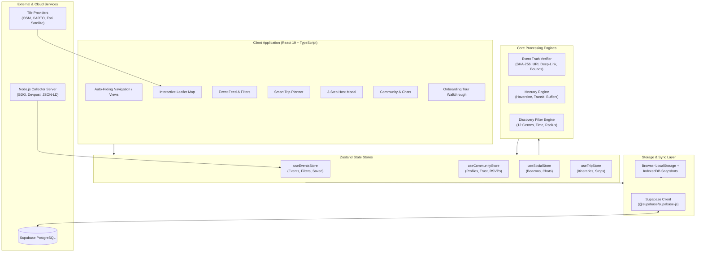

# DO — Local Event Discovery, Community & Smart Trip Engine

> **DO** is a modern, high-performance, decentralized local event discovery, community engagement, and AI-inspired trip & itinerary planning platform. Built with **React 19**, **TypeScript**, **Vite**, **Leaflet**, **Zustand**, and **Supabase**.

[]()
[]()
[]()
[]()
[]()

---

## Table of Contents

1. [What is DO & What is it Useful For?](#-what-is-do--what-is-it-useful-for)
   - [Target Users & Real-World Use Cases](#-who-is-it-useful-for)
   - [Core Features at a Glance](#-core-features-at-a-glance)
2. [Executive Summary & Vision](#executive-summary--vision)
3. [Key Capabilities & Feature Architecture](#key-capabilities--feature-architecture)
   - [Interactive Map & Spatial Discovery](#interactive-map--spatial-discovery)
   - [Event Filtering & City Catalog](#event-filtering--city-catalog)
   - [Smart Trip Planner & Itinerary Engine](#smart-trip-planner--itinerary-engine)
   - [Community, Profiles & Trust Reputation](#community-profiles--trust-reputation)
   - [3-Step Event Hosting Wizard](#3-step-event-hosting-wizard)
   - [Event Truth Verifier & Data Integrity](#event-truth-verifier--data-integrity)
   - [Public Event Ingestion & Scraper Radar](#public-event-ingestion--scraper-radar)
   - [Cloud Sync & Supabase Backend](#cloud-sync--supabase-backend)
   - [Admin Portal & Maintenance Console](#admin-portal--maintenance-console)
   - [UI/UX & Design System](#uiux--design-system)
4. [System Architecture & Data Flow](#system-architecture--data-flow)
5. [Project Structure](#project-structure)
6. [Getting Started & Local Setup](#getting-started--local-setup)
7. [Environment Configuration](#environment-configuration)
8. [Comprehensive User Walkthrough](#comprehensive-user-walkthrough)
9. [Testing & Quality Assurance](#testing--quality-assurance)
10. [License & Credits](#license--credits)

---

## 💡 What is DO & What is it Useful For?

**DO** is a real-time event discovery, social coordination, and intelligent travel engine built to connect people with verified happenings around them and across the globe. Rather than treating events as static bulletin boards or cluttered ticketing links, DO combines **interactive geographic exploration**, **algorithmic multi-day itinerary generation**, and **verified community engagement** into a single cohesive, high-performance experience.

### 🎯 Who is it Useful For?

| User / Persona | What They Use DO For | Real-World Benefit |
| :--- | :--- | :--- |
| 🌆 **Locals & Urban Explorers** | Discovering what’s happening tonight, tomorrow, or this weekend nearby. | No more endless scrolling through social media or dead links. Instant filtered view of concerts, tech meetups, art popups, food markets, and outdoor gigs within walking or driving distance. |
| 🎒 **Travelers & Weekend Trippers** | Automatically generating multi-day city itineraries with realistic transit times. | Generates optimized day-by-day schedules (morning, afternoon, evening, night) with Haversine distance calculations, 45-minute transit buffers, and one-click iCal (`.ics`) export to Google/Apple Calendar. |
| 🎤 **Event Hosts & Communities** | Publishing physical or virtual events in 3 simple steps without paywalls. | Custom cover images, guest limits, interactive map pin drop, private ticket/joining instructions revealed only upon RSVP, and built-in live attendee chat rooms. |
| 💻 **Remote Learners & Digital Nomads** | Finding global virtual hackathons, webinars, and livestreams. | Dedicated virtual feed with automatic IANA timezone conversion, attendee count, and direct launch links. |
| 🤝 **Social Gatherers & Meetup Groups** | Connecting with verified attendees and spontaneous neighborhood plans. | Ephemeral "I'm Free" radar beacons for quick meetups, verified attendee trust scores (0–1000) to minimize no-shows, and dedicated event discussion threads. |

---

### ✨ Core Features at a Glance

DO is packed with production-ready features designed for speed, privacy, and an effortless user experience:

- 🗺️ **Interactive Spatial Map & Radar**:
  - **3 Map Layers**: Dark Matter (OSM), CARTO vector basemap, and Esri World Imagery (Satellite).
  - **Category-Coded SVG Markers**: Real-time pulsating radar rings for live events, color-coded across 12 distinct genres.
  - **Deterministic Pin Decluttering**: Automatic collision spreading ensures venues sharing the same location are easily clickable.
  - **In-Memory GPS Centering**: Adjustable radius filtering (5 km to 100+ km) without tracking or persisting your location coordinates to a remote server.

- 🔍 **Multi-Dimensional Event Discovery**:
  - **12 Curated Genres**: Tech, Music, Nightlife, Food, Art, Sports, Business, Outdoor, Social, Photography, Gaming, and Books.
  - **Real-Time Temporal Filters**: *Live Now*, *Today*, *Tomorrow*, *This Weekend*, or specific custom date pickers.
  - **Budget & Price Intelligence**: Free vs. Paid filters with automatic multi-currency conversion (USD, INR, EUR, JPY).
  - **Global City Catalog**: Covers international metropolises (Tokyo, Berlin, San Francisco, Bangalore, Barcelona) alongside comprehensive Kerala regional districts.

- 🗓️ **Algorithmic Smart Trip & Itinerary Engine**:
  - Automatically builds 1- to 14-day balanced travel schedules based on your chosen city, travel dates, pace, and vibe.
  - Calculates transit feasibility, walking/driving distances, and enforces 45-minute travel buffers so you never double-book.
  - Swap events within a 5 km radius or insert custom personal stops (cafes, hotels, monuments).
  - 1-click export to standard **RFC 5545 iCalendar (`.ics`)**, shareable URL links, or portable JSON.

- 💬 **Live RSVP & Real-Time Event Chat Rooms**:
  - One-click RSVP ("Going" / "Interested") with live capacity meters.
  - Real-time discussion room for every event so attendees can coordinate logistics, rides, or meetups.
  - Host broadcast announcements pinned to the top of the event room.

- 🛡️ **Community Trust & Reputation System**:
  - Transparent trust score engine (0 to 1000) rewarding verified attendance, event hosting, and constructive participation.
  - Organizer entry gates: Hosts can set minimum trust tiers to prevent spam and reduce no-shows.
  - Customizable personas (Explorer vs. Organization) with handles, bios, and interest tags.

- 🧙‍♂️ **3-Step Event Hosting Wizard**:
  - **Step 1: Basics** — Title, Category, Dates & Times, high-res Unsplash presets or custom image upload.
  - **Step 2: Location** — Interactive Leaflet map pin-drop, physical venue address, or virtual meeting URL.
  - **Step 3: Access & Tickets** — Capacity caps, ticket pricing, trust gating, and secret RSVP-only access notes.

- 🔒 **Event Truth Verifier & Anti-Scraping**:
  - Cryptographic SHA-256 fingerprinting prevents duplicate listings across sources.
  - Deep-link sanitizer strips tracking cookies and UTM params, verifying authentic direct ticket destinations.
  - Coordinate and ISO 8601 validation guards against bad data.

- ⚡ **Resilient Dual Architecture (Offline-First + Cloud Sync)**:
  - **Works 100% Offline**: Full feature set runs client-side immediately without an account or cloud setup, saving your changes to IndexedDB snapshots and `localStorage`.
  - **Supabase Cloud Sync**: Drop in your Supabase credentials to instantly turn on multi-user synchronization, real-time websockets, and cloud persistence.

- 🛠️ **Admin Maintenance Portal & Public Ingestion Radar**:
  - Secure passphrase-gated admin console (`/admin`).
  - Standalone Node.js ingestion scraper for public feeds (Google Developer Groups, Devpost, Luma, Eventbrite).
  - Complete JSON database backup, restore, and storage quota diagnostics.

---

## Executive Summary & Vision

DO bridges the gap between passive event directories and real-world social participation. It answers the fundamental question: *"What is happening around me right now, and how do I experience it effortlessly?"*

The application is engineered with a **resilient dual-mode architecture**:
- **Zero-Dependency Local-First Mode**: Functions out-of-the-box without mandatory cloud credentials or accounts. Seed events, IndexedDB persistent snapshots, and browser `localStorage` provide an immediate, private, ultra-fast experience.
- **Real-Time Cloud Synchronization**: Automatically connects to **Supabase** when environment keys are detected, unlocking live multi-user event persistence, auth sessions, cloud beacons, global chat streams, and collaborative trip schedules.

---

## Key Capabilities & Feature Architecture

```
                                  ┌────────────────────────┐
                                  │      DO PLATFORM       │
                                  └───────────┬────────────┘
         ┌──────────────────┬─────────────────┼──────────────────┬──────────────────┐
         ▼                  ▼                 ▼                  ▼                  ▼
  ┌──────────────┐   ┌──────────────┐  ┌──────────────┐   ┌──────────────┐   ┌──────────────┐
  │ Interactive  │   │  Smart Trip  │  │  Community   │   │ Event Truth  │   │ Cloud / Sync │
  │ Map & Radar  │   │   Planner    │  │   & Trust    │   │   Verifier   │   │ & Ingestion  │
  └──────────────┘   └──────────────┘  └──────────────┘   └──────────────┘   └──────────────┘
   • 3 Basemaps       • 1-14 Day Plans  • Trust Score      • Anti-Scrape      • Supabase DB
   • SVG Category     • Transit Calc    • Ephemeral        • SHA-256 Dupes    • Node Collector
     Pins             • Safe Swaps        Beacons          • Strict URL       • Offline
   • Collision        • iCal (.ics) &   • Live Event         Deep Links         IndexedDB
     Spreading          JSON Export       Chat Rooms       • ISO Bounds         Snapshots
```

### 1. Interactive Map & Spatial Discovery
- **Multi-Layer Map Tiles**:
  - **OpenStreetMap (OSM)**: Clean monochrome dark-mode treatment.
  - **CARTO Vector Basemaps**: High-clarity light/dark basemaps (configurable via `VITE_CARTO_API_KEY`).
  - **Esri World Imagery**: Full-color high-resolution satellite photography.
- **Custom SVG Category Markers**: 12 distinct category icons with color codes, pulsating animations for live events, and custom badge counts.
- **Deterministic Pin Spreading & Clustering**: Eliminates marker stacking at identical coordinates by smoothly spiderifying nearby venue pins.
- **Interactive Dropped-Pin Hosting**: Click anywhere on the map to drop a pin, extract exact coordinates, and launch the event host modal directly.
- **Ephemeral "I'm Free" Social Radar**: Visual beacon wave on the map signaling spontaneous gatherings.
- **In-Memory GPS Geolocation**: Strict privacy preserving GPS requests—coordinates stay in client memory and are never persisted without permission.

### 2. Event Filtering & City Catalog
- **12 Curated Genres**: Tech, Music, Nightlife, Food, Art, Sports, Business, Outdoor, Social, Photography, Gaming, and Books.
- **Multi-Dimensional Temporal Filtering**: Live Now, Today, Tomorrow, This Weekend, Specific Date, This Week, Upcoming Year, or Anytime.
- **Broad Geography**:
  - Pre-seeded flagship hubs: **Bangalore**, **Tokyo**, **Berlin**, **San Francisco**, **Barcelona**, and worldwide coverage.
  - Priority support for Kerala districts: Kozhikode (Calicut), Kochi, Trivandrum, Thrissur, Kannur, Wayanad, etc., with dedicated district anchors.
  - Location Scopes: City, Nearby Radius (5 km – 50 km+), State/Region, Country, and Worldwide.
- **Unified 4-Way Autocomplete Search**: Instantly parses districts, cities, specific venues, and event titles in a single search bar.
- **Dedicated Virtual Feed**: Online/hybrid events with IANA timezone conversion, attendee limits, and direct meeting links.

### 3. Smart Trip Planner & Itinerary Engine
- **Algorithmic Multi-Day Schedules (1–14 Days)**: Computes realistic, enjoyable itineraries based on selected city, date ranges, and vibe preferences.
- **Customizable Pacing**:
  - `Chill`: 2 curated stops per day.
  - `Balanced`: 3 curated stops per day.
  - `Packed`: 4 high-energy stops per day.
- **Budget Intelligence**: Filters by Free, Budget (<$25 USD with currency conversion for INR, JPY, EUR, USD), or All.
- **Time Bracket Slots**: Automatically groups events into Morning, Afternoon, Evening, and Night brackets.
- **Transit & Feasibility Optimization**:
  - Uses Haversine distance calculations and transit estimation algorithms.
  - Enforces **45-minute connection buffers** and **3-hour relaxation gaps** between distant stops.
  - Displays visible warning badges for tight connections or travel conflicts.
- **Safe Swaps & Custom Stops**: One-click swap for alternative events within a 5 km radius, or inject custom stops (cafes, hotels, landmarks) with bespoke notes.
- **Universal Export & Sharing**:
  - **RFC 5545 iCalendar (`.ics`)**: Import directly into Google Calendar, Apple Calendar, and Outlook.
  - **JSON Travel Plan Export / Import**: Portable backup of your entire trip.
  - **URL Share Links**: Encode trip configurations into shareable web links.

### 4. Community, Profiles & Trust Reputation
- **Dual Personas**: Explorer and Organization profiles with customizable avatars, bios, home cities, and interest tags.
- **Guest Browsing by Default**: First-time visitors browse freely in Guest mode with locked preview teasers (photo, title, city, time); one click unlocks a profile to reveal venue addresses and RSVP actions.
- **Dynamic Trust Score Engine (0–1000 Clamped)**:
  - Host verified event: `+15`
  - Activate beacon: `+5` (once per beacon)
  - Verified attendance: `+20`
  - Positive 5-star rating: `+5`
  - No-show penalty: `-35`
- **RSVP Gating**: Organizers can require a minimum trust tier for entry.
- **Ephemeral "I'm Free" Beacons**: Broadcast availability for 2, 4, or 6 hours with a custom vibe message, target radius, and district anchor. Auto-purged on expiration.
- **Live Event Chat Rooms**: Real-time communication per event for confirmed RSVPs, host broadcast announcements, and automatic read-only archiving once concluded.
- **Host Followings & Smart Notifications**: Real-time notifications for host announcements, RSVP updates, 1-hour pre-event reminders, and post-event reviews.

### 5. 3-Step Event Hosting Wizard
- **Physical or Virtual Mode**: Supports physical venues with map pin drop or online events with private meeting URLs.
- **8 Pre-Built Templates**: Casual hangouts, tech workshops, music gigs, outdoor treks, hackathons, dinner clubs, art exhibitions, and gaming nights.
- **Cover Image Manager**: Upload custom JPG, PNG, or WebP images with dimension checks, or select from high-resolution Unsplash presets.
- **Capacity & Access Controls**: Unlimited vs max guest caps, open vs waitlist status, and minimum trust score threshold.
- **Private Access Instructions**: Security instructions or video links kept hidden from public view and revealed only to confirmed RSVPs.

### 6. Event Truth Verifier & Data Integrity
- **Anti-Hallucination & Provenance Tracking**: Categorizes event origins (`demo`, `community`, `collected`, `pulse-import`) and applies strict validation rules.
- **Cryptographic Fingerprinting**: Computes SHA-256 hashes based on title, city, and date to prevent duplicate listings.
- **Strict URL Deep-Link Enforcement**: Rejects generic root directories (e.g. `eventbrite.com/d/`, `meetup.com/find/`) and enforces verified event ticket pages.
- **Temporal & Coordinate Integrity**: Verifies ISO 8601 timestamps, ensures end dates occur after start dates, and validates finite coordinates within valid geographic bounds.

### 7. Public Event Ingestion & Scraper Radar
- **Independent Node.js Collector (`server/collector.mjs`)**:
  - Live adapters for **Google Developer Groups (GDG)** and **Devpost Hackathons**.
  - Permitted JSON-LD structured data extractors for Luma, Eventbrite, Meetup, Devfolio, Resident Advisor, and World Athletics.
  - Safe circuit breakers: 18s timeouts, 4 MB response caps, max 2 concurrent requests, 5-minute memory cache, and strict loopback controls.
  - Dedicated CLI: `npm run collect` and `npm run collect:watch`.

### 8. Cloud Sync & Supabase Backend
- **Direct PostgreSQL Integration**: Structured tables for `events`, `profiles`, `rsvps`, `beacons`, `trips`, `messages`, and `reviews`.
- **Hybrid Offline/Cloud Store**: Synchronizes local state with cloud database upon connection. Offline changes are safely retained in IndexedDB and re-synced.
- **Secure Authentication**: Email and password authentication with persistent session storage and automatic JWT token refresh.

### 9. Admin Portal & Maintenance Console
- **Passphrase-Protected Maintenance Mode**: Access restricted to administrators (`admin@do.com`, `salif@do.com`, or passphrase `do-admin-2026`).
- **Event Lifecycle Controls**: Full CRUD, live edit, reversible soft-archive, restore, and permanent deletion.
- **Scraper Ingestion Radar**: Inspect source response times, accepted vs excluded event metrics, and run on-demand ingestion.
- **Storage Diagnostics**: Inspect IndexedDB snapshot records, download full JSON backups, and restore missing items.

### 10. UI/UX & Design System
- **Auto-Hiding Laptop Sidebar**: Clean distraction-free view where the sidebar smoothly slides out when moving the cursor to the left screen edge.
- **Compact 4-Step Onboarding Tutorial**: Interactive, skippable walkthrough introducing discovery, map navigation, trip planning, and live chats.
- **Responsive Mobile Bottom Sheet**: Touch-friendly drawer with fluid drag handle (`MobileSheetHandle`).
- **Tri-Theme Engine**: Light mode, dark mode, or system device preference with persistent theme selection.
- **Resilient Error Boundary & Quota Manager**: Catches runtime UI errors gracefully and automatically purges old cached items to prevent localStorage exhaustion.

---

## System Architecture & Data Flow



---

## Project Structure

```text
pulse-horizon/
├── .env.example                   # Environment configuration template
├── .env.local                     # Local environment keys (Supabase, CARTO)
├── package.json                   # Dependencies, scripts, and build targets
├── tsconfig.json                  # Strict TypeScript configuration
├── vite.config.ts                 # Native Vite bundler with HTTPS & collector proxy
├── tailwind.config.js             # Styling configuration
├── FEATURE_PARITY.md              # Pulse analysis & feature mapping report
├── VALIDATION.md                  # Verification benchmarks & test boundaries
│
├── public/                        # Static assets
│   ├── images/                    # Bundled high-res cover photography (Unsplash)
│   ├── data/                      # Collected event datasets & reference imports
│   └── sw.js                      # Service Worker caching application shell
│
├── scripts/
│   └── collect.mjs                # CLI runner for one-off/periodic collection
│
├── server/
│   ├── collector.mjs              # Fixed-source public API & JSON-LD parser
│   ├── collector.d.mts            # TypeScript declarations for collector
│   └── collector.test.mjs         # Collector unit tests
│
└── src/
    ├── App.tsx                    # Main app coordinator, sidebar, dialogs
    ├── main.tsx                   # React 19 application entry point
    ├── domain.ts                  # Core TypeScript types and data contracts
    ├── stores.ts                  # Events, Trips, and Social Zustand stores
    ├── communityStore.ts          # Profiles, RSVPs, Trust index, and Admin state
    ├── styles.css                 # Design system, glassmorphism, responsive styles
    │
    ├── components/                # React UI Components
    │   ├── ui.tsx                 # Atomic UI primitives (Modal, Avatar, Toast, etc.)
    │   ├── MapView.tsx            # Leaflet map, pins, pulses, satellite tiles
    │   ├── EventFeed.tsx          # Virtualized event grid/list presentation
    │   ├── EventCard.tsx          # Rich event preview card with badges
    │   ├── EventDetails.tsx       # Full event modal with truth audit & ticket links
    │   ├── EventImage.tsx         # Lazy-loaded cover image with genre fallbacks
    │   ├── DiscoveryControls.tsx  # Search bar, genre chips, radius, filter drawer
    │   ├── TripWorkspace.tsx      # Multi-day trip timetable, transit, day tabs
    │   ├── TripCreationModal.tsx  # Trip generator wizard (pace, budget, vibes)
    │   ├── HostModal.tsx          # 3-step physical/virtual event publishing wizard
    │   ├── CommunityViews.tsx     # Profiles, Explorer workspace, Tour modal
    │   ├── SocialModals.tsx       # "I'm Free" beacon modal and room launchers
    │   ├── AuthModal.tsx          # Supabase Sign Up / Sign In modal
    │   ├── AdminAuthModal.tsx     # Passphrase-protected site maintenance portal
    │   ├── ConsoleModal.tsx       # Admin event management & collector console
    │   ├── DataPanel.tsx          # Storage diagnostics & JSON backup/restore
    │   ├── EditProfileModal.tsx   # Edit display name, handle, bio, city
    │   ├── EditInterestsModal.tsx # Manage preferred event genres
    │   ├── ThemeToggle.tsx        # Light / Dark / Device theme switcher
    │   ├── MobileSheetHandle.tsx  # Touch-friendly mobile bottom sheet handle
    │   └── ErrorBoundary.tsx      # React crash guard & state recovery
    │
    ├── data/                      # Reference & Seed Datasets
    │   ├── cities.ts              # Global cities, timezones, Kerala districts
    │   ├── globalCities.json      # Comprehensive global city coordinates dictionary
    │   └── mockEvents.ts          # Seed catalog covering 7 flagship cities
    │
    └── services/                  # Business Logic & Integrations
        ├── supabase/              # Supabase Cloud Integration
        │   ├── client.ts          # Supabase client singleton & health check
        │   ├── types.ts           # Generated PostgreSQL database types
        │   ├── authService.ts     # User sign-up, sign-in, session listener
        │   ├── eventsService.ts   # Event querying, upserting, soft-archiving
        │   ├── communityService.ts# Cloud profiles, RSVPs, trust sync
        │   ├── beaconsService.ts  # Cloud beacon publishing & querying
        │   ├── tripsService.ts    # Cloud trip itinerary persistence
        │   └── messagesService.ts # Real-time event chat discussions
        ├── eventTruthVerifier.ts  # SHA-256 fingerprinting & structural verification
        ├── eventUrls.ts           # Deep-link cleaner & authentic URL builder
        ├── itineraryEngine.ts     # Multi-day itinerary generator & transit math
        ├── calendar.ts            # RFC 5545 iCalendar (.ics) export & trip parser
        ├── filters.ts             # Multi-variable event filtering engine
        ├── geo.ts                 # Haversine distance, bounds & transit estimates
        ├── geolocation.ts         # In-memory browser GPS coordination
        ├── markers.ts             # Deterministic pin collision spreading
        ├── time.ts                # Timezone math, countdowns & live status
        ├── persistence.ts         # IndexedDB snapshots & localStorage quota guard
        ├── scraper.ts             # Multi-source scraper adapters
        └── uuid.ts                # Fast RFC-compliant UUIDv4 generator
```

---

## Getting Started & Local Setup

### Prerequisites
- **Node.js**: Version 18.0 or higher (Node 20+ recommended).
- **npm**: Version 9.0 or higher.

### Installation

1. Clone or navigate to the project directory:
   ```sh
   # Clone the repository
   git clone https://github.com/your-username/do.git
   cd do/pulse-horizon

   # Or if you already have the project folder open:
   cd pulse-horizon
   ```

2. Install dependencies:
   ```sh
   npm install
   ```

3. Start the development server:
   ```sh
   npm run dev
   ```
   Open `http://127.0.0.1:5173/` in your browser.

4. Useful CLI scripts:
   ```sh
   # Run with self-signed HTTPS (recommended for geolocation testing)
   npm run dev:https

   # Build for production with TypeScript type-checking
   npm run build

   # Preview the production bundle locally
   npm run preview

   # Run ESLint across the codebase
   npm run lint

   # Execute the entire Vitest test suite (112 tests)
   npm test

   # Run one-off public event collector (GDG & Devpost)
   npm run collect

   # Run continuous 30-minute collector loop
   npm run collect:watch
   ```

---

## Environment Configuration

The application works completely offline without any configuration. To enable cloud synchronization or CARTO basemaps, create a `.env.local` file inside `pulse-horizon/`:

```sh
# pulse-horizon/.env.local

# Supabase Project Configuration (for real-time cloud sync, auth, and cloud persistence)
VITE_SUPABASE_URL=https://your-project-ref.supabase.co
VITE_SUPABASE_ANON_KEY=your-supabase-anon-key
VITE_SUPABASE_PUBLISHABLE_KEY=your-supabase-publishable-key

# Optional CARTO basemap key for ultra-sharp vector street tiles
# (Without a key, DO defaults to clean monochrome OpenStreetMap tiles)
VITE_CARTO_API_KEY=
```

---

## Comprehensive User Walkthrough

### Step 1: Navigating the Interface & Exploring Events
1. **Auto-Hiding Sidebar**: On desktop/laptop screens, the sidebar neatly hides to maximize screen space. Move your mouse to the **left screen edge** to smoothly slide out the navigation panel.
2. **Top Bar Search & Discovery**:
   - Type in the top search bar to auto-complete between **Districts**, **Cities**, **Venues**, or **Event Titles**.
   - Use the **City Dropdown** to jump between Bangalore, Tokyo, Berlin, San Francisco, or Kerala hubs (Kozhikode, Kochi, etc.).
   - Click the genre chips (Tech, Music, Food, Art, etc.) or time filters (Live, Today, Weekend) to filter listings instantly.
3. **Map Navigation**:
   - The interactive map displays all matching events. Colored pins represent categories, and pulsing markers indicate events currently in progress.
   - Click the layer control in the bottom right of the map to switch between **Streets**, **Mono**, and **Satellite** imagery.
   - Click the **Re-center** button to frame all events on screen, or click the **GPS** button to center around your current physical location.

### Step 2: Unlocking Guest Mode & Profiles
1. New users start in **Guest Mode**. Event cards display photos, titles, and dates, but exact venue addresses and RSVP buttons are guarded.
2. Click any event card and press **"Choose my profile"**.
3. Select an existing persona (e.g. Alex, Salif, Amal) or create your own profile with custom interests and home city.
4. Your trust index (0–1000) and badges immediately activate in the top right profile button.

### Step 3: Hosting a New Event
1. Click the **"+ Host"** button in the sidebar or top bar (or right-click/drop a pin on the map).
2. **Step 1 (Basics)**: Choose Physical or Online, pick an event template (e.g. Tech Talk, Music Night, Workshop), enter title, description, and upload a cover photograph.
3. **Step 2 (Schedule & Location)**: Set start and end timestamps. For physical events, type a venue name or click on the map to place an exact GPS pin.
4. **Step 3 (Access & Capacity)**: Set free or paid ticket pricing, guest limits, optional minimum trust score requirement, and private RSVP instructions (e.g. door access codes or video call links).
5. Click **"Publish Event"**—the event immediately appears on the map, in the feed, and synchronizes to Supabase.

### Step 4: Activating an "I'm Free" Social Beacon
1. Want to meet nearby creators or friends right now? Click **"I'm Free"** in the sidebar.
2. Select your vibe duration (2 hours, 4 hours, or 6 hours), type a short message (e.g., *"Grabbing coffee at Blue Tokai, join me!"*), and choose your district.
3. Click **"Turn On Beacon"**. A pulsating beacon ring appears on the map for all local users, earning you `+5` trust points.

### Step 5: Building a Multi-Day Trip with the Itinerary Engine
1. Click **"Plan Trip"** in the navigation bar.
2. Choose your destination city, start date, and end date (1 to 14 days).
3. Select your vibe preferences (e.g. Music + Food + Art), pacing (`Chill`, `Balanced`, or `Packed`), and budget tier.
4. Click **"Generate Itinerary"**:
   - The engine automatically calculates an optimal day-by-day timetable.
   - Inspect travel times between stops (Haversine formula), transit buffers, and conflict alerts.
   - Click **"Swap"** to substitute any stop with an eligible venue within 5 km.
   - Click **"+ Add Custom Stop"** to insert hotels, restaurants, or personal detours.
5. Click **"Export .ics"** to sync your trip with Google Calendar, or **"Share"** to generate a portable link.

### Step 6: Live Event Chat & Post-Event Feedback
1. RSVP to any upcoming event to unlock its dedicated **Live Chat Room**.
2. Chat with the host and fellow attendees in real time.
3. Once the event concludes, return to the event modal to submit your **Attendance Review**:
   - Confirm attendance (`+20` trust points).
   - Rate the experience 1–5 stars and select compliments (e.g., *Great Crowd*, *Well Organized*).

### Step 7: Administrator Portal & Site Maintenance
1. Open the Onboarding Tutorial (click **"?"** or Help in the navigation), and click the discreet **"Site maintenance"** link at the bottom (or open Admin Login).
2. Enter the administrator passphrase: `do-admin-2026` (or sign in with `admin@do.com` / `salif@do.com`).
3. Unlock full maintenance controls:
   - Edit, soft-archive, or permanently delete any event.
   - Monitor the **Event Scraper Radar** and trigger on-demand collection from GDG and Devpost.
   - Inspect IndexedDB snapshots and download portable JSON database backups.

---

## Testing & Quality Assurance

DO includes a comprehensive **Vitest** test suite verifying domain contracts, calculation engines, security rules, and data parsers:

```sh
npm test
```

### Verified Test Suites (106 Passed Tests):
1. **`server/collector.test.mjs`** (5 tests): Public API collection, timeout boundaries, caching, and error resilience.
2. **`src/services/authService.test.ts`** (8 tests): Email validation, password complexity, handle prefixing, and role assignments.
3. **`src/services/uuid.test.ts`** (3 tests): RFC-compliant UUIDv4 format, distribution, and collision immunity.
4. **`src/services/geolocation.test.ts`** (2 tests): Geographic bounds, coordinates normalization, and distance math.
5. **`src/services/search.test.ts`** (5 tests): Global city resolution, district mapping, venue query parsing, and worldwide discovery.
6. **`src/services/adminAccess.test.ts`** (4 tests): Administrative authorization, passphrase validation, and role protection.
7. **`src/services/community.test.ts`** (8 tests): Trust score clamps, attendance rewards, no-show penalties, and RSVP limits.
8. **`src/services/collection.test.ts`** (22 tests): Ingestion audits, pulse reference normalization, link sanitization, and price validations.
9. **`src/services/eventUrls.test.ts`** (17 tests): Deep link canonicalization, generic directory detection, and ticket page integrity.
10. **`src/services/supabase.test.ts`** (8 tests): Supabase database connection, cloud event mapping, beacon broadcasting, and trip storage.
11. **`src/services/engine.test.ts`** (24 tests): Multi-day itinerary synthesis, slot brackets, tight-connection alarms, and safe swaps.

---

## License & Credits

- **Cover Photography**: Bundled photographs licensed via [Unsplash](https://unsplash.com/).
- **Icons**: [Lucide Icons](https://lucide.dev/).
- **Maps & Basemaps**: [OpenStreetMap](https://www.openstreetmap.org/), [CARTO](https://carto.com/), and [Esri World Imagery](https://www.esri.com/).
- **Fonts**: DM Sans and Space Grotesk via Google Fonts.

Developed with precision for local discovery, decentralized communities, and seamless travel planning.
